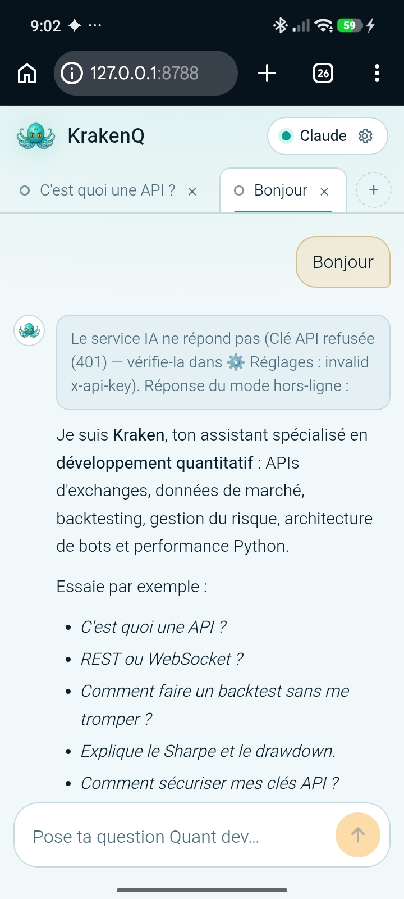
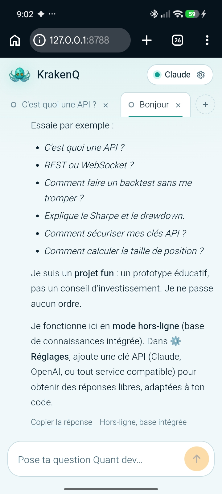
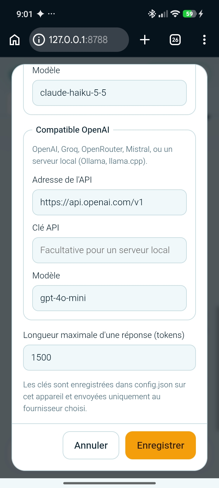
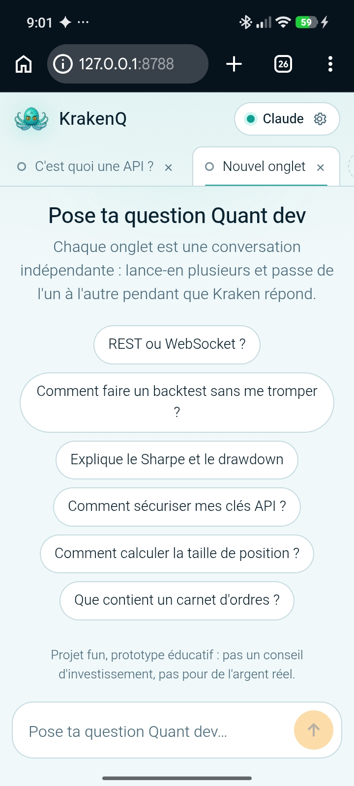

# 🐙 KrakenQ

Prototype éducatif d'assistant IA dédié au **développement quantitatif** (APIs d'exchanges, backtesting, gestion du risque, bots Python).

---

## 📸 Aperçu & Fonctionnalités

### 1. Interface de Chat & Mode Hors-Ligne (Fallback)
Même en cas d'erreur de clé API ou sans connexion, KrakenQ continue de répondre grâce à sa **base de connaissances intégrée** :

<p align="center">
  
  
</p>

### 2. Support Multi-IA & Clés API Personnalisées
Tu peux configurer tes propres clés API (Claude / Anthropic, OpenAI, Groq, OpenRouter) ou pointer vers un serveur local (Ollama) :

<p align="center">
  
  
</p>

---

## 🚀 Lancement rapide sur Termux

```bash
pkg install python unzip
termux-setup-storage
cp ~/storage/downloads/krakenq.zip ~ && cd ~ && unzip krakenq.zip && cd krakenq
python app.py

